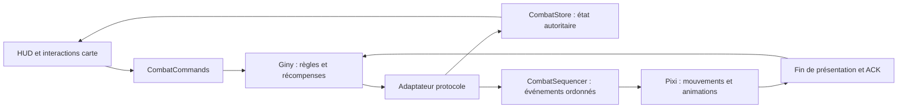

# Combat PvM : audit et plan d’implémentation

Mise à jour après implémentation : [livraison jouable, tests et limites de couverture](COMBATS-IMPLEMENTATION-2026-09-05.md). Les constats ci-dessous décrivent l’état initial de l’audit.

Audit du 5 septembre 2026. Périmètre : client `client/web`, serveur Giny local et build Bubble 0.1.328 dans `resources/app.asar`. Lecture statique du code ; aucun combat réel ni benchmark exécuté. Ce document prépare l’implémentation : il ne signifie pas que les fonctionnalités décrites sont déjà jouables.

**Le moteur de règles existe côté Giny. Le chantier principal consiste à construire le client de combat : état synchronisé, commandes, scène tactique, présentation des séquences et résultats.** Réutiliser les fenêtres officielles et PixiJS existants. S’inspirer de l’organisation de Bubble sans reprendre ses règles ou son protocole tels quels.

## 1. État actuel

| Parcours demandé | Présent | Travail manquant |
| --- | --- | --- |
| Groupes de monstres sur la carte | Giny crée les groupes ; le snapshot expose leur acteur et le look du chef ; Pixi sait charger les acteurs distants | Composition, niveaux, variantes modulaires, statut attaquable, survol/clic des acteurs, apparitions/disparitions en direct |
| Détail au survol | Données de groupe dans les types et classes serveur | Projection moderne de ces données, tooltip raccordé au picking Pixi, éventuellement estimations XP/drop issues des règles Giny |
| Lancer un combat | Handler d’attaque et création `FightPvM` | Déplacement vers le groupe, confirmation, requête d’attaque, changement de contexte et gestion des refus |
| Placement et challenges | Cases des équipes, minuterie, état prêt, propositions et validation des challenges côté serveur | Décodage, état client et contrôles UI ; plusieurs validations serveur à corriger |
| Tours et sorts | Timeline, PA/PM, portée, ligne de vue, effets, IA, historique de sorts côté serveur ; catalogue de sorts côté HUD | CombatStore, commandes, barre utilisable, zones de portée/effet, déplacement tactique, synchronisation des tours |
| Animations | Lecteur de clips, mouvements, `playAttack`, résolveur de noms d’animations | Lecture sans boucle avec fin attendable, file de séquences, réactions, morts, projectiles, VFX, sons et annulation |
| Drops et fin | Tirages, XP/kamas, application à l’inventaire et message de fin côté serveur ; arbres UI extraits | Décodage des résultats réels, quantités, participants, progression XP, affichage et retour à la carte |

Points d’entrée :

- `server/Servers/Giny.World/Handlers/ModernClientHandler.cs` : le snapshot de carte ne contient actuellement que l’identité, le nom, la cellule, la direction et le look des acteurs ; aucune composition de groupe.
- `client/web/src/giny/GinyClient.ts`, `dispatchFrame` : aucun traitement de `MODERN_FIGHT_SNAPSHOT`. Son identifiant existe dans `messages.ts`, mais le message arrive dans la file générique des messages non consommés.
- `server/Servers/Giny.World/Managers/Modern/ModernFightSnapshot.cs` : combattants, timeline et `last_action`, mais pas de phase, acteur actif, minuterie, placement, challenges ni résultats. Envois repérés au démarrage, au lancement d’un sort et à la fin d’une séquence racine de sort : ce n’est pas une synchronisation complète.
- `client/web/src/ui/game/combatPresentation.ts` : contrat d’aperçu explicite ; ennemi, statistiques et certains libellés codés en dur. `loot: number[]` ne permet pas de restituer les quantités.
- `client/web/src/ui/game/GameHud.tsx` : timeline et bouton de tour ajoutés par le mode développeur `combat-preview=preparation`, pas par une phase de combat réseau.
- `client/web/src/game/renderer/GameRenderer.ts`, `onLeftClick` : interactions de décor et déplacements hors combat ; pas de routage attaque/placement/sort.

## 2. Ce que Bubble apporte

Le [relevé JSON](AUDIT-COMBATS-GINY-BUBBLE-2026-09-05.json) conserve les chemins internes, SHA-256 des modules inspectés, extraits et positions des symboles. Ce sont des observations du build livré, pas une validation de son comportement en jeu.

Dans `dist/assets/game-entry-D5YuSIvZ.js` :

- `MonsterGroupTooltip` : présentation dédiée et logique de projection des drops. Réutiliser le principe d’un tooltip riche ; les formules doivent venir de Giny et de sa configuration.
- Autour de `__MonsterGroupAttack` : attaque immédiate si le personnage est déjà sur la cellule, sinon déplacement avec attaque au callback d’arrivée. C’est cohérent avec le handler Giny.
- `_sequenceBuffer`, `_sequenceDepth`, `_flushSequenceBuffer` : regroupement des messages entre début et fin de séquence, puis émission d’une séquence complète. Le build traite aussi une fin de combat reçue alors qu’une séquence reste ouverte.
- `_fightSequenceMovementComplete` et `enqueueActorSequenceCommand` : attente explicite des déplacements et commandes par acteur, avec chemins d’annulation/abandon.
- `HurrySequencePlayback` : mécanisme de rattrapage de lecture ; événements distincts pour glissade, téléportation, échange, porter/jeter, invisibilité, tacle, coup, sort et invocation.
- Phases `starting`, `placement`, `battle` : les actions de clavier et les contrôles dépendent de la phase, du tour du joueur et du statut spectateur.
- Présence des vues de résultats personnage/résumé/statistiques et d’un événement audio de résultat.

Les modules `fight-Czbxl41R.js`, `challenge-Cs23h8rB.js` et `game_action-BY5ovYju.js` contiennent des schémas de messages. Ils ne constituent pas à eux seuls les contrôleurs de combat. Les familles de challenges diffèrent de celles de ce serveur Giny : les sérialiseurs C# locaux restent la référence.

## 3. Architecture proposée

Organisation suggérée, fichiers à créer :

| Fichier ou module | Responsabilité |
| --- | --- |
| `src/giny/combatTypes.ts` | Contrats des phases, combattants, challenges, séquences, résultats et commandes |
| `src/giny/combatParsers.ts` | Décodage des messages C# locaux, polymorphisme inclus, validation des bornes et identifiants |
| `src/giny/combatState.ts` | État observable, réduction des événements, reconnexion, isolation par session/contexte/tour |
| `src/giny/combatCommands.ts` | Attaquer, placer, choisir les challenges, prêt, déplacer, lancer, passer, quitter, ACK |
| `src/game/combat/CombatSequencer.ts` | Ordre des présentations, tâches par acteur, fin/annulation, délais bornés, rattrapage |
| `src/game/combat/CombatScene.ts` | Combattants Pixi, cercles d’équipe, picking, positions et transitions de contexte |
| `src/game/combat/CombatGrid.ts` | Accessibilité tactique, occupation, portée, ligne de vue, zones |
| `src/game/combat/SpellVisuals.ts` | Résolution locale des ressources, étapes de sort, projectiles, impacts et sons |
| `src/ui/game/monsterGroupTooltip.ts` | Projection des groupes vers les bindings du tooltip |
| `src/ui/game/combatController.ts` | Contrôleurs du HUD officiel et des résultats, en remplacement des données d’aperçu |

Le store autoritaire et la présentation doivent être distincts. Le serveur peut déjà avoir calculé les dégâts alors que le projectile est encore affiché. Conserver les événements intermédiaires : un diff entre deux snapshots ne permet pas de reconstituer un vol de vie, une poussée suivie d’un piège ou plusieurs pertes de PV.

**Choix conseillé : décoder les événements de combat standards existants, compléter la projection moderne pour l’initialisation et la resynchronisation.** Éviter un polling de snapshots après chaque clic. Si un flux JSON de combat est préféré pour limiter les décodeurs binaires, il devra représenter les mêmes séquences, états et résultats, avec version de schéma, révision et resynchronisation ; le snapshot actuel seul ne suffit pas. Ne pas appliquer deux fois le même effet depuis le flux standard et la projection moderne.

États locaux : `roleplay → approachingGroup → joining → preparation → fighting → finishing → roleplay`. La sélection des challenges est un sous-état de préparation. Le résultat reste conservé dans un état indépendant : le personnage peut déjà être revenu sur la carte avec la fenêtre de résultat ouverte. Sur un refus d’attaque, retour à `roleplay` ; sur reconnexion, adoption de l’état serveur sans rejouer les anciennes actions.

Chaque commande vérifie la phase, le combattant contrôlé, les droits, le tour et les actions en cours. La validation définitive appartient toujours à Giny. Les commandes de combat ne doivent pas être simplement ajoutées au handler moderne existant : `ModernActionsHandler` refuse globalement les actions pendant un combat.

## 4. Groupe, tooltip et attaque

Étendre le snapshot de carte avec un objet de groupe typé : identifiant, cellule, chef, membres `{monsterId, grade, level, name, look}`, effectif, niveau total, possibilité d’attaque et alternatives pour les groupes modulaires. Les membres sont accessibles via `MonsterGroup.GetMonsters()` ; `ModularMonsterGroup` contient les alternatives dépendant de la taille de l’équipe. Éviter de promettre que le tooltip d’un groupe modulaire est déjà la composition définitive du combat.

Ajouter des mises à jour d’acteurs pour apparition, déplacement, disparition et engagement du groupe. Un groupe ne doit pas rester visible simplement parce qu’il était dans le snapshot d’entrée de carte.

Le picking doit sélectionner l’acteur visible selon son ordre de rendu, puis ouvrir un tooltip ancré dans le viewport : noms, niveaux individuels, niveau total et éventuellement drops possibles. Fermer/invalider au changement de carte, à la disparition du groupe et à l’entrée en combat. Distinguer la liste des drops possibles des gains réellement tirés. Les éventuelles estimations doivent intégrer les taux Giny, la prospection et les règles de groupe ; sinon les omettre.

Au clic : mémoriser l’identifiant du groupe et la génération de carte, demander le chemin, jouer le chemin confirmé, envoyer sa confirmation, revérifier le groupe et envoyer `GameRolePlayAttackMonsterRequestMessage`. Le serveur exige `character.CellId == group.CellId`. Gérer le groupe qui bouge/disparaît entre le clic et l’arrivée, le chemin refusé et le double clic. Annuler l’intention si le joueur change de destination ou de carte.

Sources serveur : `Handlers/Roleplay/Maps/MapsHandler.cs`, `Managers/Entities/Monsters/MonsterGroup.cs` et `ModularMonsterGroup.cs`.

## 5. Préparation, challenges et emplacement

À réception du contexte combat et des combattants, conserver le décor mais remplacer les acteurs de monde par les combattants. Charger les cases depuis `GameFightPlacementPossiblePositionsMessage`, avec l’équipe indiquée par le serveur. Dans la création PvM actuelle, les monstres sont ajoutés à `BlueTeam` et le personnage à `RedTeam` : ne pas supposer que « le joueur est toujours bleu ».

Le clic de placement envoie une demande ; déplacer visuellement le combattant après confirmation des dispositions. N’autoriser que les cellules de placement de son équipe, libres et valides. Le bouton prêt suit l’état confirmé et devient indisponible quand le combat commence. Prévoir l’échange de positions avec un allié en tenant compte des limitations du handler actuel, qui échange directement et ne présente pas un parcours d’offre/acceptation complet.

Le serveur fournit actuellement 30 secondes de placement. `GetPlacementTimeLeft()` renvoie des dixièmes de seconde ; la durée de tour est également envoyée en dixièmes, alors que la durée finale du combat est en millisecondes. Normaliser ces unités dans l’adaptateur et utiliser une échéance monotone pour le compte à rebours client.

Pour les challenges :

1. Recevoir le nombre et choisir le mode, puis confirmer via `ChallengeReadyMessage`.
2. Afficher les propositions de `ChallengeProposalMessage` et leur délai de 15 secondes.
3. Le chef sélectionne (`ChallengeSelectionMessage`), les membres voient la sélection confirmée.
4. Le chef valide (`ChallengeValidateMessage`), puis réception de `ChallengeAddMessage` et de l’éventuelle proposition suivante.
5. Chaque combattant doit disposer du choix de bonus XP/drop conforme à la règle retenue côté serveur.
6. En combat, afficher les challenges actifs, leurs cibles et leur succès/échec confirmés.

Le code prévoit un challenge en map normale et deux en donjon. Au démarrage, les propositions non sélectionnées entraînent actuellement une randomisation ; corriger le cas où cette randomisation remplace aussi les choix déjà validés. Le serveur doit exposer clairement quand le joueur peut dire prêt et quand le choix de challenge est terminé.

## 6. Tours, déplacements et barre de sorts

Afficher le HUD selon la phase réelle : préparation/challenges, prêt/pas prêt, puis passer le tour. Construire la timeline depuis les combattants réels : ordre, actif, morts, invocations, PV et boucliers. Afficher PA/PM/PV du combattant contrôlé, y compris lors du contrôle d’une invocation.

La barre de sorts utilise le catalogue et les raccourcis existants, mais ajoute disponibilité, coût effectif, états, relance initiale/globale, limites par tour et par cible. `spell.activate` correspond à l’activation d’un sort du personnage ; ce n’est pas une commande de lancement en combat.

Sélectionner un sort affiche sa portée ; survoler une cible affiche sa zone ; cliquer envoie la cellule au serveur. Annuler avec Échap, sur changement de tour, mort du lanceur ou changement de contexte. Les raccourcis doivent ignorer le chat et les champs de saisie.

Ne pas réutiliser tel quel le pathfinding de déplacement libre : il possède huit directions et la grille utilise `nonWalkableDuringRp`. Le lecteur serveur `PathReader.FightMove` reconstruit les déplacements sur les axes tactiques. Ajouter une grille de combat à quatre voisins, les cellules `nonWalkableDuringFight`, les combattants bloquants, le budget PM et le tacle. La prévisualisation doit rester indicative lorsque le serveur peut interrompre le trajet, notamment sur un piège.

`Fighter.CanCastSpell` et l’historique de sorts sont les références pour les validations. Les aperçus client ne doivent jamais décrémenter définitivement les PA/PM ou retirer des PV avant confirmation.

## 7. Séquences et animations

Trois messages ont des rôles différents :

| Action | Message Giny |
| --- | --- |
| Le joueur est prêt au placement | `GameFightReadyMessage` |
| Le joueur demande de passer son tour | `GameFightTurnFinishMessage` |
| Le client a terminé sa présentation après une demande de synchronisation | `GameFightTurnReadyMessage`, en réponse à `GameFightTurnReadyRequestMessage` |

`Synchronizer` attend le client au début du combat, en fin de tour et en fin de combat. Répondre après les présentations nécessaires, y compris lors du tour d’un monstre. `SequenceEndMessage` fournit l’identifiant d’action ; `GameActionAcknowledgementMessage` confirme la séquence selon les règles du handler local. Ce dernier n’accepte actuellement cet ACK que du personnage dont c’est le tour : ne pas confondre cet ACK avec celui de synchronisation globale.

Construire un séquenceur avec une file ordonnée et des tâches attendables. Pour un sort : orientation → animation du lanceur → départ du projectile/effet → impact → réaction, nombres et changements visuels → mort éventuelle → fin de séquence. Les cibles d’un même impact peuvent jouer en parallèle, tout en respectant les dépendances de déplacement, mort, invocation et effet déclenché.

Travaux nécessaires :

- Exposer une API d’animation non bouclée renvoyant une fin ou une annulation. Aujourd’hui `playAttack()` passe par `applyPose()`, qui appelle `player.play(..., true, ...)` : le clip est bouclé.
- Charger les clips requis via `clipLoader`, avec annulation et durée maximale. Un clip absent ne doit jamais bloquer le tour ; appliquer un repli visuel et terminer la tâche.
- Résoudre les données locales de scripts/VFX. `spellScripts.ts` sait seulement extraire un `animId` et choisir des noms de clips. Aucun appel de production à son hydratation n’a été identifié ; l’appel serveur à `SendCast` ne fournit pas `scriptId`, qui reste à zéro.
- Répertorier et préparer localement les ressources d’effets, leurs points d’attache, timings, projectiles, impacts et sons. Les assets d’interface de combat déjà présents ne prouvent pas la couverture des VFX des sorts.
- Couvrir déplacements, corps-à-corps, dégâts, soins, boucliers, morts, invocations, poussées/attirances, téléportations/échanges, porter/jeter, transformations, invisibilité, glyphes, pièges et portails. Adapter chaque famille aux effets réellement implémentés par Giny.
- Borne de file, annulation par génération de contexte et rattrapage en cas de retard. Une séquence interrompue par une fin de combat doit être clôturée proprement, sans exécuter une ancienne animation dans la carte suivante.
- Libérer les effets, listeners et textures temporaires ; conserver les caches partagés bornés déjà disponibles.

La validation de « toutes les animations » nécessite un inventaire par script/effet. Un sort qui joue correctement ne suffit pas à déclarer cette couverture terminée.

## 8. Drops, résultats et retour au monde

`FightPvM.GenerateResults()` calcule XP, kamas et objets ; `FightPlayerResult.Apply()` crédite le personnage avant l’envoi de `GameFightEndMessage`. La fenêtre présente donc des gains déjà attribués. Sa fermeture ne doit jamais appeler une attribution supplémentaire.

Conserver un résultat immuable avec : contexte du combat, issue par participant, durée, vainqueurs/vaincus, niveaux, XP gagnée et seuils, kamas et objets `{gid, quantity}`. Préserver les grandes valeurs d’XP sans perte de précision. Hydrater les noms/icônes depuis les données locales et prévoir un libellé de repli si une donnée manque.

Ouvrir automatiquement `fightResult` avec ses lignes réelles ; remplacer toutes les constantes d’aperçu. La jauge d’XP vient des seuils réels. Les statistiques détaillées de dégâts/soins/boucliers doivent être accumulées à partir des événements ou exposées côté serveur ; ne pas afficher des zéros inventés si ces données sont absentes, notamment après reconnexion.

Laisser terminer les dernières présentations avec une limite, répondre à la synchronisation de fin, puis traiter le résultat et les messages de retour au monde. Rafraîchir inventaire, XP, vie, kamas, quêtes et acteurs de carte. Supporter victoire, défaite, abandon, mort simultanée, changement de salle et fin reçue pendant un chargement. Un abandon avant démarrage ne produit pas forcément de `GameFightEndMessage` : le changement de contexte doit aussi restaurer le HUD.

La reconnexion dispose déjà d’un chemin serveur (`CharacterFighter.OnReconnect`) envoyant combattants, timeline, synchronisation, reprise de tour et relances. Adapter l’entrée du client, qui attend aujourd’hui un parcours de carte classique, et restaurer le combat sans attente impossible de `CurrentMap`.

## 9. Corrections serveur à traiter avant la recette

Constats du code, sauf mention explicite ; leur fréquence en jeu n’est pas mesurée.

| Priorité | Constat | Correction et test attendu |
| --- | --- | --- |
| P0 | Placement : `FightsHandler` vérifie disponibilité et case libre, mais pas l’appartenance aux `PlacementCells` de l’équipe ; `ModifyPlacement` affecte directement la cellule | Valider bornes, cellule autorisée, phase et occupation avant modification ; refuser une case libre hors zone |
| P0 | Échange de placement : `target.Cell` est lu sans vérifier que `target` existe ; contrôle d’alliance absent dans ce handler | Valider cible, équipe, phase, disponibilité et cases ; tester identifiant inconnu et adversaire |
| P0 | `FightChallenges.ValidateChallenge` utilise `Selected.GetChallengeInformation()` même si l’ID ne correspond pas à la proposition | Valider la proposition courante, phase, sélection et double validation ; aucune exception ni second ajout |
| P0 | `ChallengeReady` peut redemander les propositions et prolonger le placement ; plusieurs handlers de choix n’excluent pas un combat déjà commencé | Introduire un état de sélection explicite et rendre les confirmations répétées sans effet |
| P0 | `ModernFightSnapshot` envoie les mêmes cellules complètes à tous les personnages, sans projection par observateur, contrairement aux informations standard de combattants | Filtrer les informations selon la visibilité avant d’utiliser cette projection ; tester un adversaire invisible |
| P1 | `ChallengeBonusChoice` compare le chef à lui-même ; cette condition ne filtre jamais un combattant | Clarifier que le bonus est individuel, comme le suggèrent le stockage sur le combattant et le calcul des gains ; valider enum et phase, retirer/corriger le contrôle incohérent |
| P1 | `OnFightStart` randomise toutes les propositions si une seule reste sans choix | Conserver les choix déjà validés ; randomiser seulement ceux qui manquent |
| P1 | `SendGameFightJoinMessage` envoie systématiquement `canSayReady=false` | Rendre la disponibilité cohérente avec la phase de préparation/challenges ; un client qui respecte ce champ ne doit pas rester bloqué |
| P1 | `Loot.AddItem(int, int)` ajoute `1` au lieu de `amount` si l’objet est déjà présent | Ajouter la quantité reçue ; tester deux ajouts de quantités supérieures à un. La surcharge prenant `DroppedItem` utilisée dans le chemin PvM lu additionne, elle, correctement |
| P1 | `CheckFightEnd` utilise `BlueTeam.Alives == 0 || RedTeam.Alives == 0 && !Ended` | Appliquer `!Ended` aux deux cas et rendre la finalisation idempotente ; tester les appels répétés, morts simultanées et attribution unique |
| À vérifier | `SequenceEnd.actionId` est un `short`, l’ACK un `byte`, et les IDs augmentent avant remise à zéro au tour suivant | Vérifier les tours à nombreuses séquences ; ne pas tronquer silencieusement l’identifiant côté client |

## 10. Lots et critères de fin

| Lot | Livraison concrète | Acceptation |
| --- | --- | --- |
| 1 — Contrats et fiabilité | Corrections P0, adaptateur d’événements, état de combat, requêtes et ACK, traces | Relecture d’un flux réel sans message critique perdu ; synchronisation de début/tour/fin ; reconnexion et messages périmés testés |
| 2 — Carte vers préparation | Groupes détaillés, survol, attaque après arrivée, scène de placement, challenges et prêt | Un personnage rejoint un groupe réel, choisit ses challenges et sa cellule ; refus et groupe disparu gérés |
| 3 — Combat jouable de bout en bout | Timeline, déplacement tactique, barre de sorts, PA/PM/PV, séquenceur et animations minimales, résultat réel | Terminer un combat PvM par actions client ; aucun tour bloqué ; gains affichés égaux aux gains serveur et inventaire |
| 4 — Fidélité des effets | Scripts locaux, VFX, réactions, déplacements spéciaux, invocations, états, sons et statistiques | Matrice de sorts/effets couverte ; ressources manquantes sans blocage ; plusieurs combats sans accumulation de ressources |
| 5 — Cas de reprise et multi-acteurs | Reconnexion, abandons, alliés, contrôle d’invocations, défis de synchronisation et donjons | Retour propre après déconnexion, fin durant animation, changement de salle et résultats reçus plusieurs fois |

**Premier jalon jouable : groupe → placement/challenges → sort → tour monstre → victoire → drops réels → retour map.** Inclure les résultats dès ce jalon permet de valider le cycle complet avant d’étendre la fidélité graphique.

Tests à écrire :

- Contrats binaires avec payloads sérialisés par les vraies classes C# : héritage, tableaux, flags, entiers signés et unités. Les champs propres recensés dans le JSON ne remplacent pas la lecture de `Serialize` et des classes parentes.
- Réducteur et séquenceur : déplacements interrompus, sorts multiples, fin de combat avant fin visuelle, asset absent, doubles messages, nouvelle session et reprise sans replay.
- Serveur : placement interdit, challenge invalide/répété, choix partiellement validé, bonus, agrégation des quantités, finalisation et récompenses uniques.
- E2E connecté à Auth/World : parcours du premier jalon, victoire/défaite/abandon, comparaison aux données serveur après résultat ; les fixtures UI seules ne prouvent pas un combat fonctionnel.

Le test actuel `ModernFightSnapshot_BuildsValidJsonStructure` sérialise un objet anonyme fabriqué dans le test ; il n’appelle pas `ModernFightSnapshot.BuildJson`. Il ne protège donc pas le vrai contrat et devra être remplacé ou complété.

## 11. Messages prioritaires

Identifiants relevés dans `server/Giny.Protocol`, spécifiques à ce dépôt. Le [JSON associé](AUDIT-COMBATS-GINY-BUBBLE-2026-09-05.json) fournit le chemin de chaque classe, davantage de messages et leurs champs propres.

| Fonction | Message | ID |
| --- | --- | ---: |
| Attaquer | `GameRolePlayAttackMonsterRequestMessage` | 9329 |
| Entrée combat | `GameFightJoinMessage` | 8166 |
| Cases possibles | `GameFightPlacementPossiblePositionsMessage` | 282 |
| Choisir une case | `GameFightPlacementPositionRequestMessage` | 7043 |
| Prêt au placement | `GameFightReadyMessage` | 4840 |
| Choix de mode challenge confirmé | `ChallengeReadyMessage` | 9700 |
| Propositions | `ChallengeProposalMessage` | 8830 |
| Validation challenge | `ChallengeValidateMessage` | 8427 |
| Début combat | `GameFightStartMessage` | 9783 |
| Début tour | `GameFightTurnStartMessage` | 217 |
| Lancer un sort | `GameActionFightCastRequestMessage` | 6438 |
| Animation de sort | `GameActionFightSpellCastMessage` | 2679 |
| Début/fin séquence | `SequenceStartMessage` / `SequenceEndMessage` | 7231 / 1586 |
| ACK d’action | `GameActionAcknowledgementMessage` | 5751 |
| Passer le tour | `GameFightTurnFinishMessage` | 3915 |
| Demande/réponse de synchronisation | `GameFightTurnReadyRequestMessage` / `GameFightTurnReadyMessage` | 379 / 9655 |
| Synchronisation combattants | `GameFightSynchronizeMessage` | 8985 |
| Résultats | `GameFightEndMessage` | 2386 |

À compléter par les dispositions, mises à jour d’acteurs, dégâts/soins/boucliers/points, mort, états, invocations, marques, refus et messages de reprise. Leurs sérialiseurs doivent être pris dans le même protocole local.
